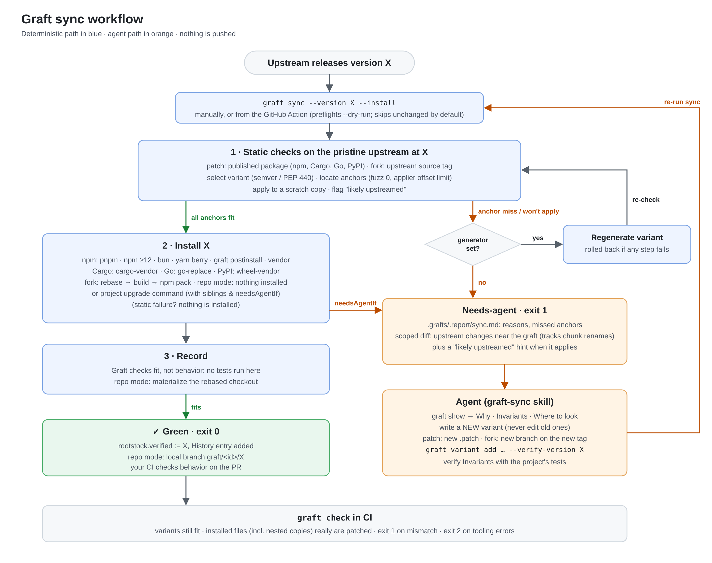

# Graft

Agent-first tooling for keeping local modifications to upstream software in sync, automatically.

Teams modify upstream dependencies with patch files, vendored copies, and forks. When upstream releases a new version, those diffs break and someone has to figure out why the patch existed and port it by hand. Graft gives coding agents and CI the missing pieces:

- an open spec for describing each modification ([`graft.md`](docs/spec.md)): its intent and **Invariants**,
- deterministic tooling (`graft`) that checks whether each modification still fits a new upstream version and carries it forward when it does,
- a structured hand-off to any coding agent when anchors move, so the agent writes a new variant and proves the Invariants with your project's own tests.

Graft does not ship an LLM or hosted service. See [`docs/why-graft.md`](docs/why-graft.md) for why it exists and [`docs/dogfood.md`](docs/dogfood.md) for how this repo uses Graft on itself.

> **Status: early development.** Works for **npm** (pnpm, npm, yarn, bun, upm), **Cargo**, **Go**, and **PyPI** (`patch` mechanism), plus git **forks** (package mode and repo mode). See [Roadmap](docs/development.md#roadmap).

## Quick start

```sh
pnpm add -D @graftsync/cli
pnpm exec graft init --agent                                      # .grafts/, plus the skill for agents
pnpm exec graft add ms-fortnight --package ms --target index.js   # graft.md + variant stub
# edit the installed package and run `graft capture ms-fortnight`
# (with pnpm, use `pnpm patch` / `pnpm patch-commit` instead of editing hardlinked node_modules)
pnpm exec graft apply                                             # wire the package manager, reinstall, check anchors
# fill in Why / Invariants / Where to look / Anchors and cover each Invariant in your test suite
pnpm exec graft sync                                              # green
pnpm exec graft sync --version 2.1.3 --install                    # upgrade, verify, bump
```

### Or hand it to your coding agent

Paste this into Claude Code, Codex, Cursor or any agent that can run shell commands in your repo:

````text
Set up Graft (https://github.com/brandonroberts/graft) in this repository so local modifications
to upstream software keep working, and keep being re-verified, when upstream releases new versions.

1. Run `npx -y @graftsync/cli@latest init --agent`, then read the graft-sync skill it installs.
   Use that same CLI (`npx -y @graftsync/cli@latest …`) for every graft command below.
2. Inspect this repository for modifications to upstream software: patch files (pnpm, bun, yarn,
   patch-package), vendored or overridden dependencies (including Cargo `[patch]`, Go `replace`,
   or Python overrides), or a fork relationship (such as an `upstream` git remote or commits on
   top of an upstream repo). Tell me what you found and confirm which modification(s) to graft
   and why they exist before changing anything. If none exist yet, ask me what we're modifying
   and why, and make the change first.
3. Scaffold the graft:
   - a dependency: `graft add <id> --package <pkg> --target <files>`, make the change in the
     installed package, then `graft capture <id>` writes it as the variant (with pnpm, use
     `pnpm patch` instead of editing `node_modules` in place: its files are hard links into the store);
   - a fork whose code is installed as a dependency: `graft add <id> --package <pkg> --mechanism fork`,
     and fill in the `fork:` block and the `{ ref, base }` variant;
   - a fork that is the product itself, with this checkout as the fork:
     `graft add <id> --package <name> --mechanism fork --in-place --version <upstream version it is based on>`.
4. Write graft.md's body: Why, Invariants (observable behaviors, one per bullet), Where to look
   (described by behavior, not file paths), Anchors, History.
   Ask me how I upgrade the package by hand. If it's more than a version bump (companion
   packages, a migration tool), record that command as `upgrade` in `.grafts/config.json`.
5. Make sure the project's own tests cover each Invariant (add tests where they don't), and
   note under Invariants which tests those are. Show they fail without the modification and
   pass with it.
6. Run `graft apply` (except for a fork that is the product), then `graft sync`, until it is
   green. `graft replay <id>` shows which published versions the variant already fits.
7. Add a `graft check` step to my CI right after dependencies are installed, so a graft that
   isn't applied fails the build. Then ask me whether to automate re-verification with the Graft
   GitHub Action (https://github.com/brandonroberts/graft/tree/main/packages/action). If I say
   yes, ask how often it should run, whether it should propose prereleases or only stable
   releases (`tags: latest`), and whether failing grafts should go to a coding agent
   (`agent-command`) or to an issue. Then add `.github/workflows/graft-sync.yml` as that README
   shows, with the action pinned to the release tag of the CLI version you used and
   `graft-command` running that same version. Tell me what I must set up on GitHub myself:
   "Allow GitHub Actions to create and approve pull requests" (or a GitHub App token), and the
   agent's API key as a repository secret.
8. Don't commit. Summarize what you set up, and show me the tests failing without the change
   and passing with it.
````

When `graft sync` reports `needs-agent`, hand the agent this (the [GitHub Action](packages/action) does this automatically with `agent-command`):

````text
`graft sync` reports that a graft needs an agent. Read .grafts/.report/sync.md, then follow the
graft-sync skill to make every graft green again for the new upstream version: add new variants
(never edit existing ones), check the result with `graft sync`, and verify every Invariant with
the project's tests without weakening them. If an invariant can no longer hold, mark the graft
conflicted instead of forcing a pass. Don't commit; summarize what changed, why, and how you
verified it.
````

## How it works



<sub>Source: [`docs/workflow.html`](docs/workflow.html), rendered at 2× with Playwright.</sub>

Each modification lives in `.grafts/<id>/graft.md` alongside its `variants/` (full format in [`docs/spec.md`](docs/spec.md)):

```markdown
---
id: request-retry
rootstock:
  package: example-http-lib
  # ecosystem: npm               # npm (default) | cargo | go | pypi
  verified: 4.2.0
mechanism: patch
variants:
  - range: ">=3.0.0 <4.0.0"
    module: ./variants/v3.patch
  - range: ">=4.0.0"
    module: ./variants/v4.patch
status: applied
---

## Why / ## Invariants / ## Where to look / ## Anchors / ## History
```

1. **Deterministic first pass (`graft sync`):** checks variant selection, anchors (exact match, fuzz 0), and apply against the **pristine** published target before touching the workspace. With `--install`, it installs only when every graft on that package passes, rolls back manifests/lockfiles/vendored files if the install fails, and bumps `verified` on green.
2. **Agent path:** anything that misses becomes `needs-agent` (exit `1`) with a scoped upstream diff in `.grafts/.report/sync.{json,md}`. The agent adds a *new* variant (existing variants are never edited) and proves the Invariants with the project's tests.

**Sync checks fit, not behavior.** Graft runs no tests of its own; behavior is verified by your tests and CI.

## Mechanisms and ecosystems

| Mechanism / Ecosystem | How Graft applies it | Details |
|---|---|---|
| `patch` — **npm** | Native `pnpm` / `npm ≥ 12` / `bun` / `yarn 2+`, vendored `.tgz` (`upm` / `vendor`), built-in `graft` (`postinstall`), or `patch-package` | [Patch appliers & silent failures](docs/mechanisms.md#patch-any-package-manager) |
| `patch` — **Cargo** | Vendored crate under `.grafts/.vendor/` + `[patch.crates-io]` (atomic lockstep sibling updates) | [Cargo, Go & PyPI](docs/mechanisms.md#other-ecosystems-cargo-go-pypi) |
| `patch` — **Go** | Vendored module under `.grafts/.vendor/` + version-qualified `replace` in `go.mod` / `go.work` | [Cargo, Go & PyPI](docs/mechanisms.md#other-ecosystems-cargo-go-pypi) |
| `patch` — **PyPI** | Repacked wheel under `.grafts/.vendor/` + `[tool.uv.sources]` (uv) or `requirements.txt` (pip) | [Cargo, Go & PyPI](docs/mechanisms.md#other-ecosystems-cargo-go-pypi) |
| `fork` (package & repo mode) | Rebased fork commits packed as a tarball (npm), or verified in place for product forks (`install: none`, e.g. [`examples/angular-tr`](examples/angular-tr)) | [Fork mechanism & repo mode](docs/mechanisms.md#fork-modification-kept-as-commits-on-a-fork) |

All mechanisms support companion-package sibling upgrades, custom `upgrade` commands (with `needsAgentIf` hand-off), and installed-copy verification in `graft check`.

## CLI and agents

```sh
graft init [--package <pkg>] [--agent]         # create .grafts/ and install the graft-sync skill
graft add <id> --package <pkg> [--ecosystem …] # scaffold graft.md and a variant stub
graft capture <id> [--version X]               # diff your edit against pristine as a variant
graft apply [<id>]                             # wire the package manager and reinstall
graft status                                   # grafts, versions, status, anchor health
graft check [<id>] [--version X]               # verify config, anchors, and installed files
graft diff <id> [<from>] [<to>]                # scoped upstream diff
graft sync [--version X] [--install]           # deterministic first pass; writes .grafts/.report/
graft outdated                                 # newer upstream versions
graft replay <id> [--range R]                  # static checks across published versions
```

Every command accepts `--json` and `--root` (exit codes: `0` ok, `1` needs attention, `2` tooling error). Agents use the same CLI plus `show`, `preview`, `variant add`, and `mark`, guided by the [`graft-sync` skill](packages/skill/SKILL.md). See [`docs/agents.md`](docs/agents.md) for agent commands, skill installation, and writing Invariants.

## GitHub Action

Run `graft check` in ordinary CI right after installing (no action needed):

```yaml
- run: npx -y @graftsync/cli@0.3.2 check   # or: npx graft check
```

Use [`packages/action`](packages/action) to poll for newer upstream versions, run `graft sync`, open PRs, and hand failures to any `agent-command`:

```yaml
- uses: brandonroberts/graft/packages/action@v0.3.2   # pin to a release tag matching the CLI
  with:
    graft-command: npx -y @graftsync/cli@0.3.2        # omit if the project depends on @graftsync/cli
    tags: latest                                      # stable releases only
    agent-command: ''                                 # optional; see packages/action/README.md
```

## Documentation

| Doc | Contents |
|---|---|
| [`docs/mechanisms.md`](docs/mechanisms.md) | `patch` appliers, silent failures, siblings, `upgrade` commands, Cargo/Go/PyPI, `fork` & repo mode |
| [`docs/agents.md`](docs/agents.md) | Concepts glossary, writing Invariants, agent CLI commands, `graft-sync` skill setup |
| [`docs/spec.md`](docs/spec.md) | Normative `graft.md` format, diagnostics, hooks, and ecosystem contract (draft v1) |
| [`docs/why-graft.md`](docs/why-graft.md) | Why Graft vs. handing every upgrade directly to an agent |
| [`docs/dogfood.md`](docs/dogfood.md) | How Graft maintains its own CJS → ESM grafts |
| [`docs/ecosystems.md`](docs/ecosystems.md) | Design notes and findings for Cargo, Go, and PyPI |
| [`docs/development.md`](docs/development.md) | Packages, writing a mechanism adapter, local setup, releasing, roadmap |
| [`docs/handoff.md`](docs/handoff.md) | Current project state, design decisions, and open work |
| [`packages/action`](packages/action) | GitHub Action inputs, outputs, tokens, and agent hand-off |
| [`CONTRIBUTING.md`](CONTRIBUTING.md) · [`SECURITY.md`](SECURITY.md) | Contributing guidelines and security reporting |

## License

MIT
