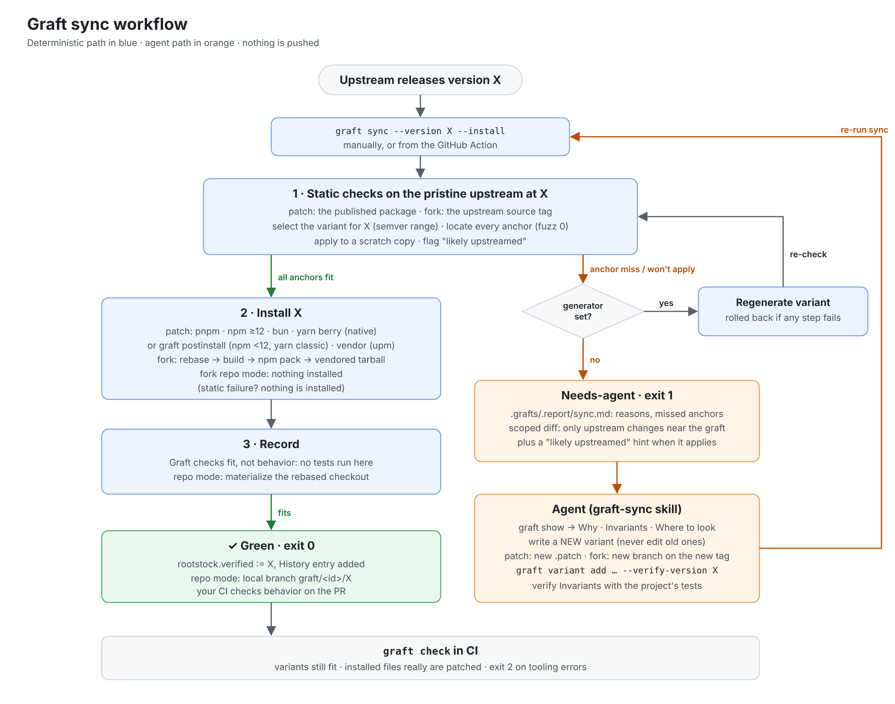

# Graft

Agent-first tooling for keeping local modifications to upstream software in sync, automatically.

Teams modify upstream dependencies with patch files, vendored copies, build transforms and forks. Each of these stores the change as a diff, or as code written against one specific upstream version. When upstream releases a new version, the modification breaks. A person then has to notice, work out what moved and fix it.

Coding agents can do that fix. What's missing is something to start them, and a record of *why* the modification exists and what must stay true. Graft supplies both:

- an open spec for describing each modification (`graft.md`): its intent and Invariants,
- deterministic tooling that checks whether each modification still fits a new upstream version, and carries it forward when it does,
- a hand-off to any coding agent, with full context, for the cases the tooling can't resolve on its own. The agent verifies the Invariants with the project's own tests.

Graft does not ship its own agent or call an LLM, and there is no hosted service.

The format and tooling contract are specified in [`docs/spec.md`](docs/spec.md) (draft v1). For how this compares with handing every upgrade to an agent, see [`docs/why-graft.md`](docs/why-graft.md).

> **Status: early development.** The spec, core, `patch` mechanism and `graft` CLI work. Graft keeps its own CommonJS dependencies converted to native ESM through its own sync loop ([dogfood](#dogfood-validation)). The agent skill and GitHub Action are built. See [Roadmap](#roadmap).

## Quick start

The flow below has been tested end to end on a real project (`ms`, adding a `fortnight` unit) with pnpm, bun and npm. The simplest way to make the variant is to edit the installed package and run **`graft capture`**, which writes the difference from the published package as the variant. With pnpm, files in `node_modules` are hard links into pnpm's shared store, so use `pnpm patch` (below) rather than editing them in place; bun has `bun patch`. With npm or yarn, Graft's built-in applier applies the variant from `postinstall` (`graft apply` sets that up).

```sh
pnpm add -D @graftsync/cli
pnpm exec graft init --agent                                      # .grafts/, plus the skill for agents
pnpm exec graft add ms-fortnight --package ms --target index.js   # graft.md + variant stub
pnpm patch ms@2.1.2                                               # edit the printed directory
pnpm patch-commit <dir> --patches-dir .grafts/tmp                 # then move the .patch onto variants/v2.patch
# (npm/yarn/bun: edit node_modules/ms/index.js, then: graft capture ms-fortnight)
pnpm exec graft apply                                             # wire pnpm to the variant, reinstall, check anchors
# write Why / Invariants / Where to look / Anchors, and a test in your suite for each Invariant
pnpm test                                                          # your tests prove the Invariants
pnpm exec graft sync                                              # green
pnpm exec graft replay ms-fortnight                               # which published versions the variant fits
pnpm exec graft sync --version 2.1.3 --install                    # a real upgrade: install, verify, bump
```

### Or hand it to your coding agent

Paste this into Claude Code, Codex, Cursor or any agent that can run shell commands in your repo. Fill in the first line.

````text
I modify <upstream package, or "this repository, a fork of <upstream repo URL>"> so that <what the
change does and why>. Set up Graft (https://github.com/brandonroberts/graft) so this modification
keeps working, and keeps being re-verified, when upstream releases new versions.

1. Run `npx -y @graftsync/cli@latest init --agent`, then read the graft-sync skill it installs.
   Use that same CLI (`npx -y @graftsync/cli@latest …`) for every graft command below.
2. Find the modification as it exists today: a patch file, an edited dependency, commits on a
   fork. If it doesn't exist yet, make it. Tell me what you found before changing anything.
3. Scaffold the graft:
   - a dependency: `graft add <id> --package <pkg> --target <files>`, make the change in the
     installed package, then `graft capture <id>` writes it as the variant (with pnpm, use
     `pnpm patch` instead of editing `node_modules` in place: its files are hard links into the store);
   - a fork whose code is installed as a dependency: `graft add <id> --package <pkg> --mechanism fork`,
     and fill in the `fork:` block and the `{ ref, base }` variant;
   - a fork that is the product itself, with this checkout as the fork:
     `graft add <id> --package <name> --mechanism fork --in-place --version <upstream version it is based on>`.
4. Write graft.md's body: Why, Invariants (observable behaviors, one per bullet), Where to look
   (described by behavior, not file paths), Anchors, History.
5. Make sure the project's own tests cover each Invariant (add tests where they don't), and
   note under Invariants which tests those are. Show they fail without the modification and
   pass with it.
6. Run `graft apply` (except for a fork that is the product), then `graft sync`, until it is
   green. `graft replay <id>` shows which published versions the variant already fits.
7. Don't commit. Summarize what you set up, and show me the tests failing without the change
   and passing with it.
````

When upstream releases, `graft sync` carries the graft forward without an agent whenever it still fits, and your CI checks behavior as usual. When it reports `needs-agent`, hand the agent this (the [GitHub Action](packages/action) does it for you with `agent-command`):

````text
`graft sync` reports that a graft needs an agent. Read .grafts/.report/sync.md, then follow the
graft-sync skill to make every graft green again for the new upstream version: add new variants
(never edit existing ones), check the result with `graft sync`, and verify every Invariant with
the project's tests without weakening them. If an invariant can no longer hold, mark the graft
conflicted instead of forcing a pass. Don't commit; summarize what changed, why, and how you
verified it.
````

## Concepts

| Term | Meaning |
|---|---|
| **Graft** | One local modification to an upstream package, described by a `graft.md` intent file. |
| **Rootstock** | The upstream package, and the last version the graft was verified against. |
| **Intent** | A plain-language description of what the modification does and why, written so an agent can act on it. |
| **Mechanism** | How the modification is applied: a patch file, a vendored copy or a fork, for example. |
| **Anchors** | What the mechanism matches on in the upstream code, and why each anchor was chosen. |
| **Variant** | One implementation of the mechanism, valid for a range of upstream versions. |
| **Invariants** | The observable behaviors the graft guarantees, and which of the project's tests cover them. Graft checks that a graft still *fits*; whoever changes it verifies the Invariants. |

## Graft layout

The full, normative description of this layout and of `graft.md` is in [`docs/spec.md`](docs/spec.md).

```
.grafts/
  config.json            # optional: upstream source overrides and resolveFrom (see below)
  <graft-id>/
    graft.md             # intent file (frontmatter + body)
    variants/            # one mechanism implementation per upstream version range
  .cache/                # fetched upstream tarballs (gitignored)
  .report/               # sync reports for CI and agents (gitignored)
```

### `graft.md`

```markdown
---
id: request-retry
rootstock:
  package: example-http-lib
  verified: 4.2.0
mechanism: patch
targets:
  - dist/index.mjs
variants:
  - range: ">=3.0.0 <4.0.0"
    module: ./variants/v3.patch
  - range: ">=4.0.0"
    module: ./variants/v4.patch
status: applied   # applied | conflicted | upstreamed | obsolete
---

## Why
What the modification enables and why upstream doesn't do it.

## Invariants
Observable behaviors that must hold, and which of the project's tests cover them.

## Where to look
The upstream area involved, described by behavior, not file path.

## Anchors
What each variant matches on, and why that anchor was chosen.

## History
- 2026-11-03: Graft created against example-http-lib@4.2.0.
```

The validator enforces:

- the frontmatter schema, with valid semver versions and ranges,
- all five body sections (an empty section is a warning, a missing one is an error),
- `id` matching the directory name,
- variant ranges that don't overlap, so every version selects exactly one variant.

It also warns when `rootstock.verified` isn't covered by any variant. Prerelease versions are included when matching ranges.

## The sync loop



<sub>Source: [`docs/workflow.html`](docs/workflow.html), rendered at 2× with Playwright.</sub>

1. **Deterministic first pass (`sync` in `@graftsync/core`).** For each active graft, the tool:
   1. selects the variant for the target version,
   2. checks its anchors,
   3. applies it to the pristine package,
   4. installs the target (with `--install`).

   If all of that passes, it bumps `rootstock.verified` and appends a History entry. Anything that fails is marked `needs-agent`, and a scoped upstream diff is written next to the report.
2. **Agent path.** The agent reads the graft, the anchor report and the scoped diff. It writes a *new* variant for the new range, verifies the Invariants with the project's tests, then records the variant. Existing variants are never edited: older ranges are narrowed instead. If the invariants can't be met, the agent marks the graft `conflicted`.

`sync` checks before it installs. Variant selection, anchors and apply run against the pristine published contents of the target version. The target is installed (with `--install`) only if every graft on that package passes, so a graft that no longer fits never breaks the install.

**Sync checks fit, not behavior.** Graft runs no tests of its own: when a variant still applies unchanged, nothing about the change moved, and your normal CI covers behavior. When a graft needs an agent, the agent proves the Invariants with your tests (and adds a test where none covers one) before recording the new variant.

Reports go to `.grafts/.report/sync.json` and `sync.md`. Exit codes: `0` all green, `1` one or more grafts need an agent, `2` tooling error.

### Writing Invariants

The Invariants are the contract, so make them checkable:
- **One observable behavior per bullet,** and name the test that covers it. If no test does, add one to the project's suite, and show it fails without the graft.
- **Test what the graft changes, not the whole stack.** For a patch that stops a dependency loading Node polyfills, assert it doesn't load them; you don't need a browser.
- **Browser tests fail on console errors and 5xx responses too,** not only uncaught exceptions: Angular, React and Vue catch errors and only log them.

## CLI

```sh
graft init [--package <pkg>] [--agent] # create .grafts/ (a starter graft; agent setup)
graft add <id> --package <pkg>        # scaffold graft.md and a variant stub
graft add <id> --package <name> --mechanism fork --in-place --version <X[+sha]>
                                      # a fork that is the product, graft in the fork (repo mode)
graft apply [<id>]                    # wire the package manager to selected variants, reinstall
graft status                          # grafts, versions, status, anchor health
graft check [<id>] [--version X]      # anchor report against installed or X
graft diff <id> [<from>] [<to>]       # scoped upstream diff
graft sync [--version X] [--install]  # deterministic first pass; writes the report
graft outdated                        # newer dist-tagged upstream versions
graft replay <id> [--range R]         # static checks across every published version
```

Every command takes `--json` and `--root`.

## Agents: CLI and skill

Agents drive Graft through the same `graft` CLI people use. Every command takes `--json` for structured output, and exit codes are `0` ok, `1` needs attention, `2` tooling error. These cover what an agent needs beyond `status`, `check`, `diff`, `apply` and `sync`:

| Command | Purpose |
|---|---|
| `graft show <id>` | The intent (all body sections), variants with resolved paths, and the variant selected for the installed version |
| `graft capture <id> [--version X]` | Write your edit of the installed package as the variant: the diff against the published package. Replaces the untouched scaffold stub, or adds a new variant (`>=X`) if a real one exists; rolls back unless it applies to pristine `X` |
| `graft preview <id> [--version X] [--out dir]` | Apply a graft's variant to pristine upstream and write the modified files for inspection; installs nothing |
| `graft variant add <id> --range R --module M [--verify-version X] [--note "…"]` | Register a new variant. Never edits existing variants. Narrows overlapping open-ended ranges (`--no-narrow` refuses instead). With `--verify-version`, rolls back unless every anchor matches there (the version must be inside the new range) |
| `graft mark <id> [--status S] [--verified X] [--history "…"]` | Set status and `verified`, and append a History entry |

The [skill](packages/skill/SKILL.md) (`graft-sync`) teaches any agent the loop and its rules:
- run the deterministic first pass first;
- read the intent before changing anything;
- never edit an existing variant;
- treat the Invariants as the contract, and verify them with the project's tests;
- never weaken a test to make a graft pass;
- know when to stop and mark `conflicted`;
- write the PR description in the given format.

To set it up in a project, run **`graft init --agent`**. It installs the skill as `graft-sync/SKILL.md` into the skills folders the project's agents already use, from the `@graftsync/skill` package:
- every existing skills folder among `.claude/skills`, `.agents/skills`, `.codex/skills`, `.cursor/skills`, `.gemini/skills` and `.github/skills`;
- failing that, `skills/` under each existing agent folder (`.claude/`, `.agents/`, `.codex/`, `.cursor/`, `.gemini/`). `.github/` alone doesn't count, since most repos have it just for workflows;
- with no agent detected, it stops before creating anything and asks for `--skills-dir <path>` (comma-separated for several), rather than guessing. `--skills-dir` always overrides detection.

Re-running updates the skill when Graft ships a new version. It also notes if `@graftsync/cli` isn't a dependency yet.

The CLI runs in the agent's shell, so it inherits the usual proxy settings (`HTTPS_PROXY`, `HTTP_PROXY`, `NO_PROXY`, and `NODE_EXTRA_CA_CERTS` for a proxy that re-signs TLS). Pristine packages are fetched by the project's own `npm` (run from the project root, so its `.npmrc` registries, scoped registries and auth apply), which must be on `PATH`.

This repo uses it on itself: [`.claude/skills/graft-sync`](.claude/skills/graft-sync/SKILL.md) links the skill.

## GitHub Action

[`packages/action`](packages/action) runs the loop, from a scheduled or manually triggered workflow. It first runs `graft check` on the installed tree, and fails the job by default if any graft isn't actually applied. With `sync: false` it does only that, which suits ordinary CI right after install. Then:
1. Poll each rootstock package's npm dist-tags.
2. Run `graft sync --install` on a branch per package@version.
3. If green, open a PR.
4. If a graft needs an agent, run your `agent-command` (with the prompt, skill and report; the agent uses the `graft` CLI), then re-run `sync` on the agent's work. Green opens a PR; still failing opens a draft PR. With no agent, or nothing to commit, it opens an issue with the report.

```yaml
      - uses: brandonroberts/graft/packages/action@main
        with:
          agent-command: ''   # optional: any agent CLI; see packages/action/README.md
```

This repo runs it on itself, triggered manually ([`.github/workflows/graft-sync.yml`](.github/workflows/graft-sync.yml)). Its first real (dry) run found yaml **3.0.0-2** on `next`. That release is native ESM, so the `yaml-esm` patch correctly no longer applies, because upstream has absorbed the graft. The action routes that to a human through an issue.

## Mechanisms

### `patch` (any package manager)

Variants are git-style `.patch` files with package-relative paths, the format `pnpm patch-commit` and `bun patch --commit` write. The same variant works with every package manager. Graft picks an *applier* from the project's package manager. An explicit `packageManager` in package.json wins. Otherwise Graft goes by lockfiles in the order **pnpm, npm, upm**, then yarn and bun, and falls back to **npm** when there's no signal. yarn 2+ (berry) is told apart from yarn classic by `packageManager: yarn@2+`, a `.yarnrc.yml` or `.pnp.cjs` next to `yarn.lock`, or berry's `__metadata:` lockfile header. To force an applier, set `{ "mechanisms": { "patch": { "applier": "vendor" } } }` (or `pnpm`, `npm`, `bun`, `yarn`, `graft`, `patch-package`) in `.grafts/config.json`.

| Package manager | Default applier |
|---|---|
| pnpm | `pnpm` (native) |
| npm ≥ 12 | `npm` (native) |
| npm < 12, yarn classic | `graft` (built-in) |
| yarn 2+ (berry), Plug'n'Play or `nodeLinker: node-modules` | `yarn` (native `patch:` protocol) |
| upm | `vendor` |
| bun | `bun` (native) |

- **Native appliers (pnpm, npm ≥ 12, bun, yarn 2+):** the package manager applies the patch and records it in its lockfile. They're preferred where they exist. npm 12's is the strictest: a patch that doesn't apply, *or matches no installed package*, fails the install; it also applies with `--ignore-scripts`, and the lockfile records the patch. npm before 12 ignores `patchedDependencies` *silently*, so Graft checks the npm version (`packageManager`, else `npm --version`) and refuses the `npm` applier below 12.
- **yarn 2+ (`yarn`):** Graft writes a name-only root resolution, `"resolutions": { "<pkg>": "patch:<pkg>@npm%3A<version>#./.grafts/<id>/variants/<variant>.patch" }`, and sets the root's own declared range to the version. yarn applies the patch while fetching, so it needs no install scripts, and it works under Plug'n'Play and `nodeLinker: node-modules` alike. The patched package gets its own checksum in `yarn.lock`, so `yarn install --immutable` fails when the variant changes without a reinstall, and a hunk that doesn't apply fails the install. The resolution pins the version, so on an upgrade `sync` rewrites it and runs a bare `yarn install`. Graft reports other resolutions of the package (`<pkg>@npm:^2`, `foo/<pkg>`) and a `patch:` dependency left by `yarn patch-commit`, because they'd compete with Graft's. yarn classic has no `patch:` protocol, so this applier refuses it.
- **The vendored override applier (`vendor`):** the default for upm, and the most universal option. It works with any package manager that supports `file:` overrides, with no install hooks at all. Graft builds *pristine upstream + the selected variant* into `.grafts/.vendor/<pkg>-<version>.tgz` and commits it. It then points the package manager at that tarball through its overrides (npm, bun and upm `overrides`, yarn `resolutions`, pnpm's overrides) and through the root's own dependency. The package manager installs the patched package as an ordinary dependency:
  - **in the lockfile:** recorded there with the tarball's integrity;
  - **durable:** it survives fresh installs, `--ignore-scripts`, and verify/"repair" passes;
  - **tree-wide:** it reaches every copy in the dependency tree.

  Tarballs are reproducible, with sorted entries and fixed timestamps and owners. Graft only rewrites one when its *contents* change, so lockfile integrity stays stable. On an upgrade it rebuilds from the new pristine version and asks `sync` for a bare reinstall, because a targeted `add <pkg>@<version>` would undo the override. The cost: tarballs are committed binary files, and the root dependency reads `file:.grafts/.vendor/…` instead of a version range.
- **The built-in applier (`graft`):** the default for npm before 12 and yarn classic, and usable with any package manager that installs into `node_modules` and runs the project's `postinstall`. Under yarn Plug'n'Play there's no `node_modules` to patch, so Graft refuses it (and `patch-package`) there with an error that names the `yarn` and `vendor` appliers. `graft apply --installed` runs in `postinstall` and patches every installed copy of the package that a variant covers, hoisted or nested. It is:
  - **offline:** it patches the installed file itself;
  - **idempotent:** a file whose *reverse* patch fits is already patched;
  - **store-safe:** it replaces files by rename (a new inode) instead of editing in place. pnpm, bun and some npm setups hardlink `node_modules` files to a shared global store, so editing in place would patch every project on the machine;
  - **strict:** it fails the install if the copy the project resolves isn't covered, or any patch doesn't fit, and it never leaves a copy half-patched.

  `sync --install` also runs it right after installing, because package managers don't run the project's `postinstall` on a targeted install.

| Package manager | How the selected variant is applied | Silent failure Graft prevents |
|---|---|---|
| pnpm | `pnpm-workspace.yaml` `patchedDependencies[<pkg>]` (name-only key) | Without `ignorePatchFailures: false`, a patch that stops applying is only a *warning*, and the package installs unmodified |
| bun | `package.json` `patchedDependencies["<pkg>@<installed>"]` | bun ignores name-only keys and keys for other versions, so an upgrade installs unpatched. Graft rewrites the key before every version change |
| npm ≥ 12 (`npm`, native) | package.json `patchedDependencies[<pkg>]` (name-only key) | npm < 12 ignores the field, so the project would install unpatched with no error. Graft refuses the native applier below npm 12 and falls back to the built-in one |
| npm < 12, yarn classic, anything else (`graft`, built-in) | `graft apply --installed` in `postinstall` | npm and pnpm skip the project's `postinstall` on a targeted install (`npm install ms@2.1.3`), so `sync --install` applies the variant itself after installing |
| yarn 2+ (`yarn`, native) | package.json `resolutions[<pkg>]` = `patch:<pkg>@npm%3A<version>#./<variant>` | The resolution pins the version: left behind on an upgrade, it keeps installing the old patched version while package.json asks for the new one. Graft rewrites it before every version change. Its name-only key also reaches copies that other packages depend on (verified on `ms` under `debug`) |
| upm, or anything with overrides (`vendor`) | `.grafts/.vendor/<pkg>-<version>.tgz` via overrides + the root dependency | upm never runs the project's `postinstall`, and `upm install --verify` silently "repairs" patched files. npm resolves `file:` overrides relative to each *dependent* and keeps stale nested lock entries, so Graft uses npm's `$<pkg>` reference and drops the package's lock entries before reinstalling |
| opt-in (`patch-package`) | A generated `.grafts/.patch-package/<pkg>+<version>.patch` (paths rewritten for patch-package), applied by `patch-package --patch-dir .grafts/.patch-package --error-on-fail --error-on-warn` in `postinstall` | Plain `patch-package` exits 0 on a failed patch outside CI, and only warns on a version mismatch. Graft renames the derived file on every version change and re-runs the bare install that triggers `postinstall` |

- **Anchors:** every hunk is an anchor. Its context and removed lines must appear exactly in the target version's file, with no fuzz, though the line position may shift. A file the patch creates must not already exist upstream.
- **Config checks:** at the installed version, `graft check` reports any configuration that would apply something other than the selected variant, or fail silently. `graft apply` and `sync --install` write the configuration.
- **Installed-copy check:** at the installed version, `graft check` also compares each patched file in `node_modules` with *pristine upstream + the selected variant*. It fails if they differ, whatever the configuration says. Under yarn Plug'n'Play, Graft resolves the installed package through the project's `.pnp.cjs` and reads its files out of yarn's zip cache with the PnP runtime (in a child `node -r .pnp.cjs`). If that runtime can't run, `graft check` prints a warning ("cannot verify installed files … under Plug'n'Play") instead of claiming the files were checked.

Each row of the table was verified against the real package manager on a real project (`ms`): install, `graft apply`, `sync`, an upgrade to a new `ms` version with `--install`, and a tampered install. The built-in applier was also verified on npm, yarn 1.22, bun, and pnpm (forced via the config override), including a second install to check idempotency. Under pnpm, every file in the content-addressed store still matched its hash afterwards. The vendored override applier was verified on upm (its default) and, forced, on npm, yarn 1.22, pnpm and bun. Each run covered a fresh install, a real upgrade, and a fresh install after the upgrade; npm also covered `--ignore-scripts`, and upm `install --verify`. The silent failures in the table are each package manager's real behavior today: pnpm 10.28, bun 1.4.4, patch-package 8.0.1, upm 1.5.1.

yarn 4.18 was verified the same way, under both Plug'n'Play and `nodeLinker: node-modules`, with the `yarn` applier (its default) and, forced, `vendor`. Each run covered `graft check` before and after `graft apply`, the patched behavior through `yarn node`, a fresh `yarn install --immutable` after clearing the install state and the cache, `sync --version 2.1.3 --install`, and a tampered install (resolution removed), which `graft check` caught; with the `yarn` applier it also caught the unpatched installed file, read from inside the zip cache under PnP. The `graft` applier was confirmed to be refused under PnP. Known gaps for yarn 2+:

- The built-in `graft` and `patch-package` appliers aren't supported under Plug'n'Play. They weren't re-verified on yarn 2+ with `nodeLinker: node-modules` either; use `yarn` or `vendor` there.
- The `yarn` applier assumes the package comes from the npm registry (`npm:` protocol). Packages from git, `file:` or `workspace:` sources need `vendor`, or a hand-written resolution.
- With yarn 2+, `sync --install` bumps a package with `yarn up`, which fails for a package no workspace declares. For a grafted package that doesn't matter: the `yarn` and `vendor` appliers pin it with a resolution and `sync` runs a bare `yarn install` instead.

**Installs that skip scripts.** `--ignore-scripts` skips `postinstall`, and with it the built-in and patch-package appliers. The native and vendored appliers don't depend on scripts. Run `graft check` in CI after installing. The GitHub Action does this by default; use `sync: false` for check-only. It compares installed files with pristine upstream + the selected variant, so it fails the build however the patch was skipped.

In a monorepo where the upstream package is declared by a workspace package rather than the root, tell Graft where to resolve it from in `.grafts/config.json`:

```json
{ "resolveFrom": { "semver": "packages/core", "yaml": "packages/spec" } }
```

### `fork` (modification kept as commits on a fork)

For teams that maintain their change as commits on a fork of the upstream source repository, rebased for each upstream release.

```yaml
mechanism: fork
fork:
  repo: https://github.com/acme/ms.git        # the fork
  upstream: https://github.com/vercel/ms.git  # the upstream source
  tag: "{version}"                            # upstream release tag (default "v{version}")
  build: npm ci && npm run build              # optional, before packing; dir: for monorepos
variants:
  - range: ">=2.1.2"
    module: ./variants/v2.json                # { "ref": "graft/fortnight", "base": "2.1.2" }
```

- **The change** is the fork's diff from `tag(base)` to `ref`. Every hunk is an anchor, located in the upstream *source* at the target version's tag (fuzz 0), and checked for "likely upstreamed".
- **Installing a version:**
  1. Graft rebases that diff onto the target tag in a fresh checkout.
  2. It runs `build`, if set.
  3. It runs `npm pack`, checking that the result packs as `<package>@<version>`.
  4. It commits the tarball as `.grafts/.vendor/<pkg>-<version>.tgz` and installs it through overrides and the root dependency, the same way as the `vendor` applier.

  This works with every package manager and is recorded in the lockfile. Graft never pushes to the fork.
- **An upstream release the fork's commits still apply to** goes through `sync` with no agent: rebase, pack, install, green.
- **A conflict** becomes `needs-agent`, with the scoped upstream `git diff`. The agent rebases the fork branch onto the new tag *in the fork*, then registers a new variant: `graft variant add <id> --range '>=X' --module ./variants/vX.json --verify-version X`.
- **At the installed version,** `graft check` rebuilds the tarball and compares it, and also compares installed files with it.

Verified end to end against the real `vercel/ms` repository with a local fork (a `fortnight` unit), on npm and pnpm:
- `apply` and a fresh install;
- `sync --version 2.1.3 --install`, which rebased the fork from `2.1.2` onto `2.1.3` automatically;
- a tampered install, which `graft check` caught.

#### Repo mode: the fork is the product

Some forks aren't dependencies at all: a translated docs site, a tool run from source. With `install: none`, nothing is packed or installed. `sync` rebases the fork's change onto the target tag in a fresh checkout, then leaves the result as the local branch `graft/<id>/<version>` in `.grafts/.cache/fork/<id>` for you to fetch. The graft can live in the fork itself (`repo: .`), and `base` may be any upstream commit, because these forks often sit between releases.

Scaffold it from inside the fork with `graft add <id> --package <name> --mechanism fork --in-place --version <upstream version>`: it writes `repo: .`, `install: none`, the upstream from the checkout's `upstream` git remote (or `--upstream <url>`), and the variant below. `--repo-mode` alone sets `install: none` for a fork kept elsewhere; `--fork-repo`, `--tag` and `--track` fill in the rest.

When the graft lives in the fork itself, use one permanent variant, `{ "ref": "@worktree", "base": "@verified" }`: the change is *this checkout* (uncommitted work included) against *the upstream it last verified*. It never needs a new variant, because the base moves with `verified`:

```yaml
rootstock: { package: angular, verified: 22.3.0-next.2+e36a63e20e }   # a release, or release+commit
mechanism: fork
fork:
  repo: .                                   # the graft lives in the fork
  upstream: https://github.com/angular/angular.git
  install: none
  track: main                               # optional: follow main's tip instead of release tags
variants:
  - { range: ">=22.0.0-0", module: ./variants/fork.json }   # { "ref": "@worktree", "base": "@verified" }
```

- **Commit targets.** `graft sync --version 22.3.0-next.3+57905ca4e6` syncs to that upstream commit. The version part is what variant ranges match; the build metadata names the commit.
- **The checkout stays true until you adopt.** A green sync records the new `verified` in the result branch, not in your checkout (which is still the fork at its old base). Adopt it as a merge of the upstream commit it sits on (the report names it), with the result's tree, so the fork keeps upstream in its history, as `git merge upstream/main` would: `git fetch .grafts/.cache/fork/<id> graft/<id>/<version> && git merge --no-ff --no-commit -s ours --allow-unrelated-histories <upstream commit> && git read-tree -u --reset FETCH_HEAD && git commit`. (A plain tree swap would drop upstream from the fork's history: a later `git merge upstream` would replay it and conflict again where it was resolved.)
- **A starting point for the agent.** On `needs-agent`, Graft prepares `graft/<id>/<version>-agent`: git's merge of the change onto the target, with conflict markers only in the files that conflict (the report lists them), and graft.md already at the new version with `status: conflicted`. Adopt it the same way (without the commit), resolve the markers, verify with the project's checks, and run `graft sync`: it checks the working tree in place. Then commit, which concludes the merge.
- **Finding new versions.** `graft outdated` offers the newest upstream release tag, or with `fork.track` the branch tip as `<version>+<commit>`.
- **Automated.** The [GitHub Action](packages/action) does all of this: it adopts green results into a PR, and for conflicts either runs your agent on the merged branch (then re-verifies) or opens a draft PR with the markers.

A ready-to-use setup for it, with a translation check for agents and a workflow, is in [`examples/angular-tr`](examples/angular-tr). Checked against the real [angular-tr](https://github.com/erkamyaman/angular-tr) (the Turkish angular.dev translation: 525 files over upstream, including 461 pages). The checks below ran on a local, history-free copy of its trees:
- **At its own base,** `sync` materialized a tree identical to the fork's branch (text, a binary image, an executable bit).
- **Onto `v22.3.0-next.3`** (also given as the commit `22.3.0-next.3+<sha>`), 2,833 hunks were checked. The 7 files that miss are exactly the ones `git apply --3way` conflicts on, and the prepared `-agent` branch has conflict markers in just those 7. One is a page the fork rewrote whole, where upstream appended a section right after it. The agent is handed a 364-line diff of what upstream changed in the 10 translated files it touched; the full upstream diff for that range is about 51,000 changed lines.
- **Upstream English that rebases cleanly** into a translated page (a 63-line addition to `i18n/deploy.md`) is not a conflict, so sync can't see it; the example's translation check (`check-pages.mjs`), which the agent runs, does.

## Dogfood validation

Graft validates itself on its own CommonJS dependencies. Three grafts convert **pacote**, **semver** and **yaml** to native ESM in this repo, so no CommonJS loads from those packages. Each is a whole-package `patch` variant. Graft's own build, tests and CLI run on the converted semver and yaml. pacote is no longer a dependency of the published packages (#20); it stays a dev dependency of this repo because it is the hardest of the three conversions, and its graft keeps proving that.

| Graft | Package | Files converted | Check (`pnpm test:grafts`) |
|---|---|---|---|
| [`semver-esm`](.grafts/semver-esm/graft.md) | semver 7.8.6 | 50 | Differential test against the pristine CommonJS release: 14,060 cases over every public function and class |
| [`yaml-esm`](.grafts/yaml-esm/graft.md) | yaml 2.9.1 | 75 | Differential test against pristine `dist/`: parse/stringify, documents, YAML 1.1 types (`!!binary` stays a `Buffer`), errors and warnings, lexer/CST |
| [`pacote-esm`](.grafts/pacote-esm/graft.md) | pacote 22.0.1 | 15 | Named exports, `require()` compatibility, `manifest`/`extract`/`tarball` end to end, and the CLI |

Each check (`.grafts/<id>/check.mjs`) runs in `esm` and `cjs` modes, as part of this repo's own tests (`pnpm test:grafts`, in CI). It uses Node's `module.registerHooks` to record the format of every module loaded from the package, and fails if any loaded as CommonJS.

The variants are generated by [`tools/cjs-to-esm`](tools/cjs-to-esm) from the pristine tarball:

```sh
node tools/cjs-to-esm/make-variant.mjs <package> <version> .grafts/<id>/variants/<name>.patch
```

Each graft declares that command as its `generator:` (with `{version}` and `{out}` placeholders), so when a release makes the variant miss, `graft sync` regenerates and registers a new variant itself, and keeps it only if it then fits and installs. Otherwise it rolls back and hands the graft to an agent. When the package no longer needs converting (it ships `"type": "module"`), the generator exits with `GRAFT_EXIT_UPSTREAMED`, and sync reports the graft as likely upstreamed instead: that's what happened with `yaml@3.0.0-2`.

The converter keeps the CommonJS semantics that consumers can observe:

- Each file's `module.exports` value is exported as `default`, as named exports, and as `'module.exports'`, so `require()` from CommonJS (Node's require-ESM support) still returns the same value. pacote's CommonJS dependencies keep using ESM semver this way.
- Top-level relative requires become live `import` bindings.
- A require that sits in a cycle *after* `module.exports =` becomes a lazy, on-demand require. This is the CommonJS export-then-require idiom: semver's Range/Comparator pair, and pacote's Fetcher base requiring its subclasses.
- Requires of *other* packages stay `require()` calls through `createRequire`, so a dual package such as minipass is never loaded twice.
- The converter refuses to convert, loudly, anything it can't translate faithfully.

What the dogfood run found:

- **Real bugs, caught by the checks before anything was committed:** minipass's dual-package entry; pacote's export-then-require cycle (`Fetcher` used before initialization); and the converter turning `new X(…)` into `new getter()(…)` (4,390 semver mismatches).
- **`graft replay` with the ranges widened:** yaml's variant applies unchanged to 2.8.0 through 2.9.1. semver's applies only to 7.8.6, because 7.8.6 added a file and changed `range.js`. pacote's applies to 22.x, because 22.0.0 rewrote `lib/dir.js`. Those releases go to the agent path instead of being silently mis-patched.
- **Earlier dogfood, against real releases:** `graft sync --install` across pacote versions, and a hand-off to an agent with no install when the patch no longer fit.

`@graftsync/core` still imports these packages in ways that work without the patches, because published consumers don't have them.

## Packages

| Package | State | Purpose |
|---|---|---|
| [`@graftsync/spec`](packages/spec) | ✅ implemented | `graft.md` schema (zod), parser and validator, comment-preserving editor, starter template. |
| [`@graftsync/core`](packages/core) | ✅ implemented | See the list below. |
| [`@graftsync/cli`](packages/cli) | ✅ implemented | `graft` command for humans and CI. |
| [`@graftsync/skill`](packages/skill) | ✅ implemented | [`SKILL.md`](packages/skill/SKILL.md) teaching agents the sync loop. |
| [`packages/action`](packages/action) | ✅ implemented | GitHub Action: poll npm dist-tags, run sync, open PRs, and hand failures to your agent. |
| [`@graftsync/adapter-patch`](packages/adapters/patch) | ✅ implemented | The `patch` mechanism and its appliers (pnpm, npm, bun, yarn, built-in, patch-package, vendor). |
| [`@graftsync/adapter-fork`](packages/adapters/fork) | ✅ implemented | The `fork` mechanism: commits on a fork, rebased, built and packed per upstream version, or (repo mode) rebased and verified in place. |

`@graftsync/core` contains:

- the `MechanismAdapter` interface and the project loader,
- upstream sources: pristine package contents fetched by the project's own npm (`npm pack`, `npm view`, so `.npmrc` registries and auth apply; cached), or local directories,
- the command runner (generators, installs, fork builds),
- scoped diffs,
- `recordVariant`, which narrows ranges and never edits existing variants,
- status, `sync`, `init`/`add` scaffolding, `outdated`, and `replay`.

All logic lives in `core` and the adapters. The CLI is a thin front-end over those functions; the GitHub Action and agents drive Graft through it.

### Writing a mechanism adapter

A mechanism plugs in by implementing `MechanismAdapter` from `@graftsync/core`:

```ts
interface MechanismAdapter {
  name: string;
  apply(ctx: GraftContext, options?: ApplyOptions): Promise<ApplyResult>;
  checkAnchors(ctx: GraftContext, version: string): Promise<AnchorReport>;
  scopeDiff(ctx: GraftContext, from: string, to: string): Promise<ScopedDiff>;
  beforeInstall?(ctx: GraftContext, version: string): Promise<void | { install?: 'reinstall' }>;
  afterInstall?(ctx: GraftContext, version: string): Promise<void>;
  applyInstalled?(ctx: GraftContext): Promise<InstalledApplyReport>;
  validateVariant?(ctx: GraftContext, variant: ResolvedVariant): Promise<void>;
  exclusivePerPackage?: boolean;
  variantExtension?: string;
  variantTemplate?(graft: { id: string; targets?: string[]; package: string }): string;
  scaffoldFrontmatter?(graft: { id: string; package: string; version: string }): Record<string, unknown>;
}
```

Every adapter must follow these rules:

1. **Fail loudly on no-match.** An anchor that's missing or matches ambiguously is an error. A graft must never silently apply nothing.
2. **Anchor by behavior.** Prefer stable exported symbols over the shape of the code, and never match on formatting.
3. **Add variants, don't rewrite them.** Older version ranges keep their variants and tests.
4. **Diff what the mechanism sees.** Work on the pristine upstream artifact the mechanism modifies, never the installed copy: the published package for `patch`, the upstream source at the release tag for `fork`.

## Development

Requires Node 22.22+, 24.15+, or 26+ and pnpm 10. All Graft packages are ESM only: import them with `import`; `require()` is not supported.

```sh
pnpm install
pnpm build      # tsc -b across the workspace
pnpm test       # vitest
pnpm lint       # oxlint
pnpm format     # oxfmt (pnpm format:check in CI)
pnpm graft status
```

## Releasing

Releases use [Changesets](https://github.com/changesets/changesets). All `@graftsync/*` packages are versioned together.

1. With a user-facing change, run `pnpm changeset`, pick a bump, describe the change, and commit the generated `.changeset/*.md` with your PR.
2. When you want to release, run the **Release** workflow manually from the Actions tab (or `gh workflow run release.yml`). It doesn't run on push. With pending changesets, it opens or updates a "Version packages" PR that bumps versions and writes changelogs (`pnpm version-packages`).
3. Merge that PR, then run **Release** again. With no changesets pending, it runs `pnpm release` (build, then `changeset publish`), which publishes every version not yet on npm. It then tags the release once, `v<version>` (the `@graftsync/*` packages share one version), and creates its GitHub release from the CLI's changelog. Re-running Release tags a published version that has no tag yet.

Prerequisites (done): the `graftsync` npm organization exists, and an npm token that can publish to it is set as the `NPM_TOKEN` repository secret. Without the secret, the workflow skips the release step.

The packages start at 0.1.0, which is not on npm yet, so the first manual run with no changesets publishes 0.1.0 as is.

## Roadmap

- **M0 — Spec and skeleton:** schema, parser, validator, adapter interface, `graft init/add/status`. *(Done.)*
- **M1 — First mechanism adapter, with a design partner.** Capture one real modification as a graft, with Invariants its project's tests cover. *(The `patch` adapter is done and dogfooded on pacote, semver and yaml; an external design partner is still to come.)*
- **M2 — Deterministic first pass in CI:** `graft check/diff/sync/verify`, reports, and a GitHub Action that opens PRs when everything passes. *(Done.)*
- **M3 — Agent path:** agent-facing CLI commands, skill file, and the action's hand-off to an agent. Evaluated by replaying historical prereleases. *(The CLI commands, skill and Action hand-off are done; the historical-prerelease eval is pending. The brief's MCP server was built and then removed: agents use the CLI.)*
- **M4 — Second, unrelated mechanism,** to prove the abstraction generalizes. Spec v1 is frozen only after this. *(The `fork` mechanism is done: git commits on a fork, rebased, built and packed per upstream version, using the same adapter interface. Freezing spec v1 is still open.)*

[`docs/handoff.md`](docs/handoff.md) is the current project handoff: architecture, the decisions that changed the original design brief (and why), milestone status and open work. The original brief is in git history.

## License

MIT
